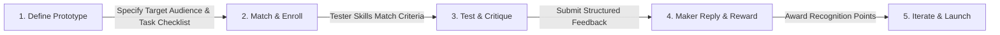

# BuildBoard

<div align="center">

**Working prototypes. Real feedback. Zero superficial launch noise.**

A collaborative platform where early-stage software builders connect with relevant beta testers to test functional prototypes, gather structured critiques, and iterate before public launch.

[](https://react.dev/)
[](https://vitejs.dev/)
[](https://tailwindcss.com/)
[](https://reactrouter.com/)
[](https://motion.dev/)
[](#-local-demo-architecture)

[Features](#-key-features) • [How It Works](#-how-it-works) • [Quick Start](#-quick-start) • [Tech Stack](#-technology-stack) • [Project Structure](#-project-structure) • [Documentation](#-deep-dive-documentation)

---

</div>

## Why BuildBoard?

Traditional launch platforms (Product Hunt, Reddit, Hacker News) are great for hype and marketing, but **painful for early validation**:

| The Traditional Launch Trap | The BuildBoard Solution |
| :--- | :--- |
| **Popularity Contests**: Prioritizes flashy graphics and upvote rings over raw product utility. | **Utility-First**: Focuses on functioning prototypes with clear "What to Try" task checklists. |
| **Superficial Feedback**: Comments like *"Great idea! Upvoted!"* provide zero actionable signal. | **Structured Critiques**: High-signal categorization (Bugs, Usability, UI, Features, Likes). |
| **Audience Mismatch**: Random users review specialized tools outside their domain of expertise. | **Explainable Matching**: Score-based engine matches products to testers by skill and role. |
| **Unrewarded Testers**: Testers spend 30 minutes testing an unpolished app and receive nothing. | **Recognition Loop**: Makers reply directly and award public Recognition Points for helpful critiques. |

---

## Key Features

### Explainable Tester Matching & Catalog
- **Target Audience Specification**: Builders define precise target criteria (roles, industries, tech stack, experience levels).
- **Match Score Engine**: Transparent recommendation scoring (+1 per matching skill/criterion) explaining *why* a prototype fits a tester's profile.
- **Instant Search & Filtering**: Multi-axis client-side filtering across keywords, categories, and technologies.

### Gated Prototype Testing & Checklists
- **Protected URLs**: Prototype links are shielded behind an enrollment gate to ensure genuine tester commitment.
- **"What to Try" Checklists**: Guides testers through critical user journeys and core feature flows.
- **Live View Tracking**: Automatically records listing visits and feeds real-time conversion stats back to builders.

### Structured Feedback & Recognition
- **Targeted Feedback Formats**: Critiques categorized by *What worked well*, *Bug / issue*, *Usability*, *UI*, or *Feature idea*.
- **Maker Reply System**: Builders can post dedicated replies directly to individual critiques.
- **Helpful Badges & Points**: Product owners endorse top feedback with a "Helpful" mark, awarding verifiable Recognition Points.

### Pre-MVP Problem Validation Forum (`/problems`)
- **Validate Before Coding**: Post raw user pain points to gauge demand before writing a line of code.
- **One-Click Validation Upvotes**: Community-backed demand signals for emerging problems.
- **Solution Linking**: Builders can attach their prototype directly as a solution to a validated problem.
- **Reddit-Style Nested Threads**: Multi-level hierarchical discussions with collapsible threads and contextual replies.

### Live Market Radar
- **Real-Time Friction & Launch Radar**: Streams live builder questions and launch discussions directly via Algolia's Hacker News REST API.
- **Resilient Client**: Native `fetch()` integration with error boundaries, loading skeletons, and `AbortController` cancellation.

### Dashboards & Analytics
- **Builder Dashboard**: Aggregated view counts, enrollment numbers, feedback counts, and conversion funnel rates with instant pause/resume controls.
- **Tester Activity Hub**: Manages enrolled prototypes, submission history, and time-tiered contextual feedback reminders (`<24h`, `24–72h`, `72h+`).

### Warm Studio Design System
- **Dark & Light Mode**: Seamless theme switching with custom warm studio palette tokens.
- **Smooth Micro-Interactions**: Physics-based 3D tilt cards, kinetic headline animations, and accessible motion with `prefers-reduced-motion` compliance.

---

## How It Works



1. **Post**: Builder submits an early prototype with target user criteria (e.g., *DevOps, Docker, Mid-Level*) and a test checklist.
2. **Match & Enroll**: Qualified testers discover the listing through explainable recommendations and enroll to unlock access.
3. **Critique**: Tester reviews the app, follows the checklist, and submits categorized, high-signal feedback.
4. **Reward**: Builder reviews the feedback, posts a reply, and marks insightful critiques as "Helpful" to award points.

---

## Quick Start

### Prerequisites
- **Node.js**: v22+ recommended (v20+ supported for frontend)
- **npm**: v10+ recommended
- **MySQL**: 8.0+ (optional for frontend-only demo; required for backend API identity sync)

### Option 1: Run Full Stack (Frontend + API)
```bash
# 1. Install frontend and backend dependencies
npm --prefix frontend install
npm --prefix backend install

# 2. Configure environment files
cp frontend/.env.example frontend/.env.local
cp backend/.env.example backend/.env

# 3. Setup MySQL database schema (if using backend)
mysql -u root -p < backend/schema.sql

# 4. Start both servers (in separate terminals or background)
npm run dev        # Starts Vite frontend on http://localhost:5173
npm run dev:api    # Starts Express API on http://localhost:3001
```

### Option 2: Frontend-Only Local Demo
```bash
# Navigate to the frontend workspace
cd frontend
npm install
npm run dev
```

Open [http://localhost:5173](http://localhost:5173) in your browser to explore the app.

---

## Available Scripts

Run these scripts from either the root directory or targeted workspace:

| Command | Action |
| :--- | :--- |
| `npm run dev` | Starts the Vite local development server for frontend (port `5173`) |
| `npm run dev:api` | Starts the Express API server with `--watch` auto-reloading (port `3001`) |
| `npm run build` | Compiles optimized frontend production bundle into `frontend/dist/` |
| `npm run lint` | Runs ESLint checks across the codebase |
| `npm run preview` | Previews the production build locally |

---

## Technology Stack

| Layer | Technologies |
| :--- | :--- |
| **Frontend Core** | [React 19](https://react.dev/), [React Router v8](https://reactrouter.com/) (`^8.4.0`) |
| **Build Tool** | [Vite 8](https://vitejs.dev/) with Fast Refresh |
| **Styling** | [Tailwind CSS v4](https://tailwindcss.com/) (`@tailwindcss/vite`), Custom CSS Design Tokens |
| **Icons & Typography** | [Lucide React](https://lucide.dev/), Google Fonts (Inter) |
| **Animations** | [Motion](https://motion.dev/) (`motion/react`) with reduced-motion support |
| **State Management** | React Context (`AuthContext`, `DemoDataContext`, `ThemeContext`) |
| **Authentication** | Firebase Authentication (email/password + email verification) |
| **API & Identity** | Node.js + Express API; Firebase Admin token verification |
| **Database** | MySQL (Firebase UID keyed identity records; app data migration is pending) |
| **Demo Data** | Browser `localStorage` + `IndexedDB` for product, feedback, problem, and media demo data |
| **External APIs** | Algolia Hacker News Search REST API (`https://hn.algolia.com/api/v1`) |

---

## Current Architecture: Firebase Auth + Local Demo Data

BuildBoard is in a staged migration from a browser-only prototype to a Node API and MySQL. Authentication is connected to Firebase; product and community data are still local demo data.

- **Authentication**: Firebase handles email/password accounts and verification emails. The frontend sends Firebase ID tokens to the Express API, which verifies them with Firebase Admin and requires a verified email.
- **MySQL identity table**: `GET /api/health` checks the API/database connection. `POST /api/auth/me` upserts the signed-in identity by Firebase UID into `backend/schema.sql`'s `users` table.
- **App data is still local**: Product listings, profiles, enrollments, feedback, and problem threads still use the browser's demo storage. They are not yet synchronized through MySQL.
- **Media via IndexedDB**: Prototype screenshots and video uploads remain in the browser's `IndexedDB` storage.
- **Local setup**: Configure `frontend/.env.local` from `frontend/.env.example` and `backend/.env` from `backend/.env.example`. Keep the Firebase service-account JSON outside the repository. Run `npm run dev` and `npm run dev:api` in separate terminals.

---

## Project Structure

```text
BuildBoard/
├── docs/                       # Architecture, decisions, and system specifications
│   ├── decision.md             # Key design and technical decision records
│   ├── flow.md                 # User flow & interaction state diagrams
│   ├── summary.md              # Project evolution & feature inventory
│   └── system.md               # Data model & state management deep-dive
├── frontend/                   # Frontend client application
│   ├── public/                 # Static assets, hero banners & demo screenshots
│   │   ├── assets/landing/     # Hero workspace mockups & graphics
│   │   └── assets/products/    # Mock prototype preview SVGs
│   ├── src/
│   │   ├── components/         # Reusable UI components (Bento grid, carousels, cards)
│   │   ├── context/            # Global state (AuthContext, DemoDataContext, ThemeContext)
│   │   ├── data/               # Default seed products, problem threads & mock users
│   │   ├── pages/              # Application pages & route views
│   │   ├── utils/              # Recommendation engine, HN API, reminder logic & storage
│   │   ├── App.jsx             # Top-level routing & layout structure
│   │   └── main.jsx            # Application entrypoint
│   └── package.json            # Frontend dependencies & build configuration
├── backend/                    # Express API, Firebase token verification, MySQL schema
│   ├── src/                    # Server, Firebase/MySQL config, auth middleware and routes
│   ├── schema.sql              # Initial MySQL users table
│   └── .env.example            # Local API configuration template
├── package.json                # Root proxy runner scripts
└── README.md                   # Project documentation
```

---

## Deep Dive Documentation

For in-depth architectural decisions, state management diagrams, and system specifications, explore the [`docs/`](./docs) directory:

-  [**Project Summary & Evolution (`docs/summary.md`)**](./docs/summary.md): Comprehensive feature inventory, rationale, and evolution fro earlier prototypes.
-  [**System Architecture & Data (`docs/system.md`)**](./docs/system.md) In-depth look at state namespaces, storage schemas, and IndexedDB hanling.
-  [**User Flows & State Transitions (`docs/flow.md`)**](./docs/flow.md) Complete journey maps for builders, testers, and problem disoverers.
-  [**Architectural Decision Records (`docs/decision.md`)**](./docs/decision.md): Detailed ADRs explaining tech stack choices and engineering trade-offs.

---

<div align="center">

Crafted with ❤️ for early-stage builders and proactive testers.

</div>
