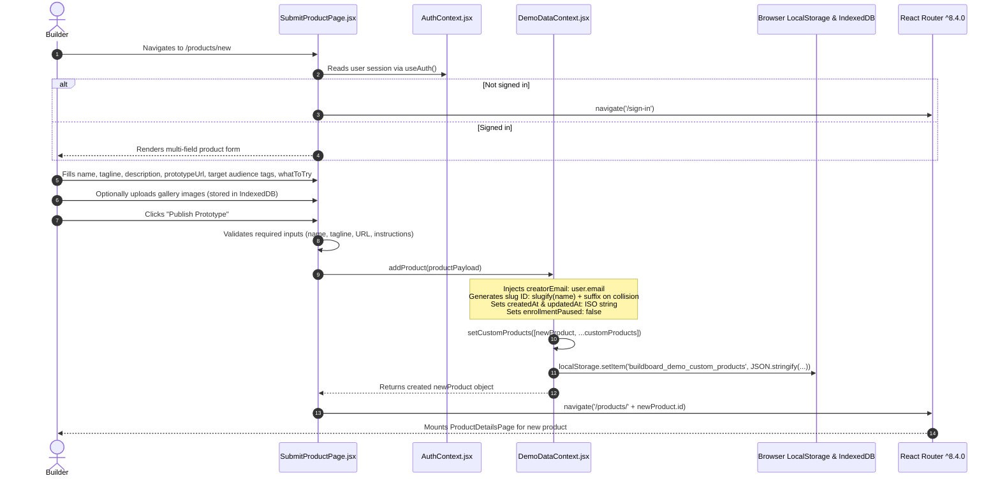
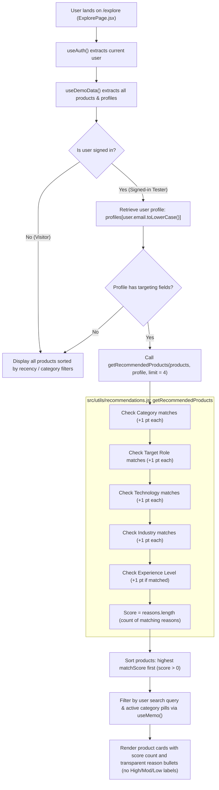
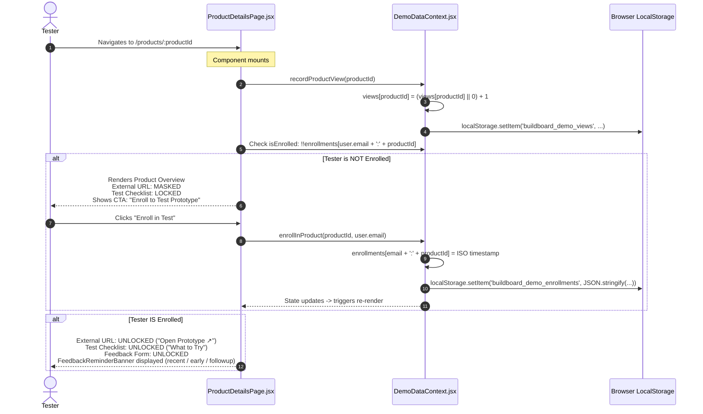
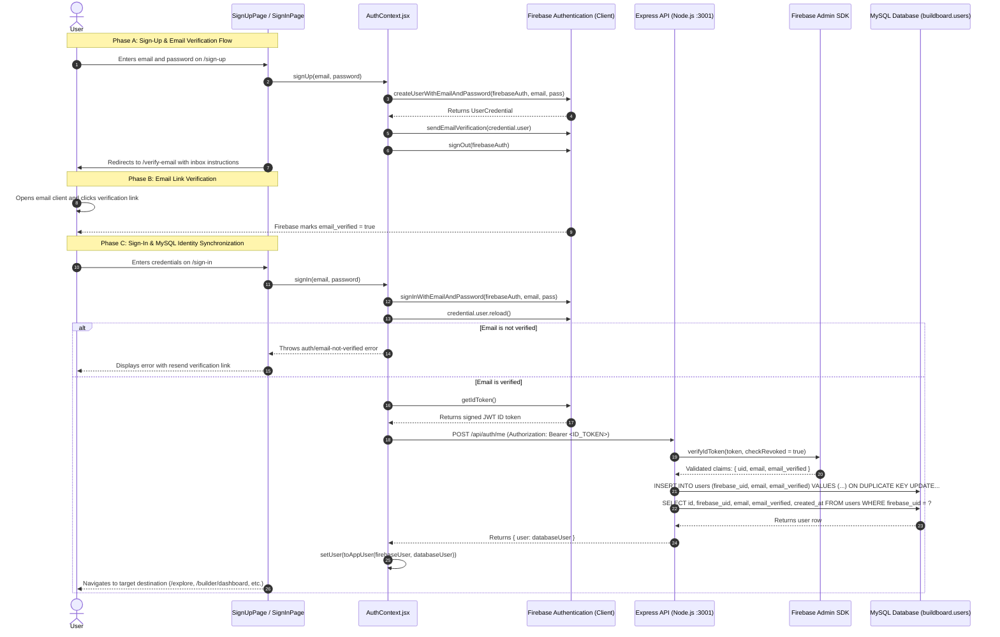

# BuildBoard — Code Execution & Data Flow Architecture (`flow.md`)

This document traces the exact step-by-step code execution flow between files, components, hooks, functions, and persistent browser storage across all major application journeys in BuildBoard.

---

## Table of Contents
1. [Application Boot & Initialization Flow](#1-application-boot--initialization-flow)
2. [Route Resolution & Code-Splitting Flow](#2-route-resolution--code-splitting-flow)
3. [Journey 1: Builder Listing Creation Flow](#3-journey-1-builder-listing-creation-flow)
4. [Journey 2: Tester Exploration & Recommendation Matching Flow](#4-journey-2-tester-exploration--recommendation-matching-flow)
5. [Journey 3: Product Mount, View Tracking & Enrollment Gate Flow](#5-journey-3-product-mount-view-tracking--enrollment-gate-flow)
6. [Journey 4: Structured Feedback Submission Flow](#6-journey-4-structured-feedback-submission-flow)
7. [Journey 5: Builder Feedback Review, Reply & Recognition Flow](#7-journey-5-builder-feedback-review-reply--recognition-flow)
8. [Journey 6: Time-Tiered Feedback Reminder Engine Flow](#8-journey-6-time-tiered-feedback-reminder-engine-flow)
9. [Journey 7: Problems Forum & Problem-to-Solution Linking Flow](#9-journey-7-problems-forum--problem-to-solution-linking-flow)
10. [Journey 8: User Authentication & Backend Identity Synchronization Flow](#10-journey-8-user-authentication--backend-identity-synchronization-flow)
11. [End-to-End Sequence Diagram](#11-end-to-end-sequence-diagram)

---
## 1. Application Boot & Initialization Flow

```
index.html
  │
  └─► src/main.jsx (Entrypoint)
        │
        ├─► <BrowserRouter> (react-router ^8.4.0)
        │     └─► Initializes HTML5 History routing context
        │
        ├─► <ThemeProvider> (src/context/ThemeContext.jsx)
        │     └─► Reads 'buildboard-theme' from localStorage
        │     └─► Synchronously injects or removes 'dark' class on <html>
        │
        ├─► <AuthProvider> (src/context/AuthContext.jsx)
        │     └─► Connects to Firebase Authentication via onAuthStateChanged (src/lib/firebase.js)
        │     └─► Enforces email verification requirement (unverified accounts cannot sign in)
        │     └─► Sends verified ID token to Express backend POST /api/auth/me
        │     └─► Receives synchronized MySQL user identity record ({ id, firebase_uid, email, email_verified })
        │     └─► Initializes user state: { uid, id, email, emailVerified, displayName }
        │
        ├─► <DemoDataProvider> (src/context/DemoDataContext.jsx)
        │     └─► Reads 9 localStorage keys (products, profiles, enrollments dictionary, feedback, views, etc.)
        │     └─► Initializes IndexedDB connection (buildboard_media_db) for local screenshots/media
        │     └─► Merges seed products (src/data/products.js) with custom user products
        │     └─► Initializes seed problems (src/data/problems.js) with custom community problems
        │     └─► Initializes all store state & exposed action handlers
        │
        └─► <App /> (src/App.jsx)
              ├─► <SkipToContent /> (Accessibility)
              ├─► <OpeningIntro /> (Mount animation - ~400ms check)
              └─► <Suspense fallback={<PageFallback />}>
                    └─► <Routes>...</Routes> (Matched page component)
                          └─► Note: Each individual page component renders its own
                              modular <Navbar /> and <Footer /> instances.
```

### Key Execution Details
1. **Context Order Dependency**:
   - `BrowserRouter` wraps the root so child providers can utilize route hooks if needed.
   - `ThemeProvider` wraps everything next so dark mode styling applies before DOM rendering (preventing white flash).
   - `AuthProvider` wraps `DemoDataProvider` because several data methods (like `addProduct` or `enrollInProduct`) infer the current user session.
   - `DemoDataProvider` reads `localStorage` synchronously during initial state declaration via lazy initializers (`useState(() => JSON.parse(...))`) to avoid re-renders or hydration mismatches, while media blobs load asynchronously via IndexedDB.

---

## 2. Route Resolution & Code-Splitting Flow

When the browser navigates to a URL (e.g., `/explore`):

```
User navigates to URL
       │
       ▼
React Router ^8.4.0 matches path in src/App.jsx
       │
       ▼
Triggers React.lazy() dynamic import (e.g. import('./pages/ExplorePage.jsx'))
       │
       ├─► Chunk not yet loaded?
       │     └─► Render <PageFallback /> (Smooth terracotta pulse skeleton)
       │
       └─► Chunk loaded:
             ├─► Mount page component (including its localized <Navbar /> & <Footer />)
             ├─► App.jsx useEffect triggers window.scrollTo(0, 0)
             └─► useDocumentTitle hook sets document.title (e.g., "Explore Products | BuildBoard")
```

---

## 3. Journey 1: Builder Listing Creation Flow

How a user creates a new prototype listing and publishes it to the catalog.



### Function Call Sequence:
1. `SubmitProductPage.jsx` → `handleSubmit(e)`
2. `useAuth()` → validates `user`
3. `useDemoData()` → `addProduct(formData)` (generates human-readable slug ID)
4. `DemoDataContext.jsx` → `setCustomProducts(prev => [created, ...prev])`
5. `DemoDataContext.jsx` → `localStorage.setItem('buildboard_demo_custom_products', ...)`
6. `useNavigate()` → `navigate('/products/' + newProduct.id)`

---

## 4. Journey 2: Tester Exploration & Recommendation Matching Flow

How the platform matches testers with products using deterministic scoring.



---

## 5. Journey 3: Product Mount, View Tracking & Enrollment Gate Flow

How prototype links and test instructions are secured until the tester enrolls.



---

## 6. Journey 4: Structured Feedback Submission Flow

How a tester submits high-signal, categorized critique.

```
ProductDetailsPage.jsx (Feedback Form Component)
  │
  ├─► Tester selects Category from 6 options:
  │     ['What worked well', 'Bug or issue', 'Usability', 'UI', 'Feature idea', 'Other']
  ├─► Tester fills 'Workflow': (e.g. "Attempted to invite a team member via OAuth")
  ├─► Tester fills 'Outcome': (e.g. "Received a blank 500 error screen on redirect")
  ├─► Tester optionally provides 'Experience' qualitative rating
  ├─► Clicks "Submit Feedback"
  │
  ▼
Calls addFeedback({ productId, category, workflow, outcome, experience, userEmail, userName })
  │
  ▼
DemoDataContext.jsx:
  ├─► Creates feedback object:
  │     {
  │       id: 'fb_' + Date.now(),
  │       productId,
  │       userEmail: user.email,
  │       userName: user.name,
  │       category,
  │       workflow,
  │       outcome,
  │       experience,
  │       likes: 0,
  │       createdAt: new Date().toISOString(),
  │       reply: null,
  │       isHelpful: false
  │     }
  ├─► setFeedback(prev => [newFeedback, ...prev])
  ├─► localStorage.setItem('buildboard_demo_feedback', JSON.stringify(...))
  │
  ▼
ProductDetailsPage.jsx Re-renders:
  ├─► Feedback appears immediately in the product's public feedback stream
  └─► Toast notification confirms submission
```

---

## 7. Journey 5: Builder Feedback Review, Reply & Recognition Flow

How builders review feedback, submit a single editable reply, and reward testers with recognition points.

```mermaid
sequenceDiagram
    autonumber
    actor Builder
    participant Details as ProductDetailsPage.jsx
    participant Dashboard as BuilderDashboardPage.jsx
    participant DemoData as DemoDataContext.jsx
    participant Activity as TesterActivityPage.jsx
    actor Tester

    Builder->>Details: Views feedback note submitted by Tester
    Note over Details: Checks creatorEmail === user.email<br/>Enables Builder Reply & Helpful Toggle
    
    Builder->>Details: Writes reply: "Fixed in patch v0.4, thank you!"
    Details->>DemoData: replyToFeedback(feedbackId, replyText)
    DemoData->>DemoData: Sets single reply object: { text, repliedBy, repliedAt, updatedAt }
    DemoData->>DemoData: Persists updated feedback array to localStorage
    
    Builder->>Details: Clicks "Mark Helpful"
    Details->>DemoData: toggleFeedbackHelpful(feedbackId)
    DemoData->>DemoData: feedbackItem.isHelpful = !feedbackItem.isHelpful
    DemoData->>DemoData: Persists updated feedback array to localStorage

    Note over Activity: Later, Tester visits /tester/activity
    Tester->>Activity: Views Recognition & Stats
    Activity->>DemoData: Reads feedback collection
    Activity->>Activity: Computes: feedback.filter(f => f.userEmail === user.email && f.isHelpful).length
    Activity-->>Tester: Displays "+1 Recognition Point" & Maker reply badge
```

---

## 8. Journey 6: Time-Tiered Feedback Reminder Engine Flow

```
Tester visits /products/:productId (ProductDetailsPage.jsx)
  │
  ▼
Calls getFeedbackReminderInfo(enrollmentTimestamp, hasSubmittedFeedback)
  │ (located in src/utils/feedbackReminder.js)
  │
  ▼
Evaluates conditions:
  ├─► Check 1: Has user already submitted feedback for this product?
  │     └─► YES: Returns null (No reminder banner rendered)
  │
  ├─► Check 2: Calculate hours elapsed since enrollment:
  │     hoursElapsed = (Date.now() - Date.parse(enrollmentTimestamp)) / (1000 * 60 * 60)
  │     │
  │     ├─► hoursElapsed < 24h:
  │     │     Tier = 'recent' ("You enrolled recently — explore the product when ready!")
  │     ├─► hoursElapsed >= 24h and < 72h:
  │     │     Tier = 'early' ("Ready to share early thoughts? The builder is eager for feedback.")
  │     └─► hoursElapsed >= 72h:
  │           Tier = 'followup' ("It's been a few days since enrollment — every critique helps!")
  │
  ▼
ProductDetailsPage renders Reminder Banner directly above the feedback section:
  │
  └─► If Tester dismisses:
        Dismissal recorded in localStorage key 'buildboard_demo_reminder_dismissals'
        Banner hides immediately
```

> [!NOTE]
> Feedback reminders are displayed as contextual banners on the **Product Details Page** via `getFeedbackReminderInfo()`. There is no separate global `getActiveReminders()` polling function on the activity page.

---

## 9. Journey 7: Problems Forum & Problem-to-Solution Linking Flow

```
1. Builder or User visits /problems/new (SubmitProblemPage.jsx)
   └─► Enters title, description/statement, category, workarounds, target role/industry
   └─► Calls addProblem() in DemoDataContext.jsx
   └─► Problem is persisted to 'buildboard_demo_problems'

2. Community views /problems/:problemId (ProblemDetailsPage.jsx)
   ├─► Calls validateProblem(problemId, user.email)
   │     └─► Toggles user email in problem.validatedBy[] array (Validation upvote)
   │
   ├─► Solution Attachment Hub:
   │     ├─► Builder clicks "Link Prototype Solution"
   │     ├─► Selects one of their products from customProducts
   │     └─► Calls attachProblemSolution(problemId, productId)
   │     └─► Bidirectional link created: problem displays linked prototype,
   │         and prototype details page displays "Solves Problem #..."
   │
   └─► Reddit-Style Nested Comment Hierarchy:
         ├─► Users post root comments or threaded replies (addProblemComment)
         ├─► Comments feature collapsible toggle arrows for nested threads
         └─► Helpful toggles allow community recognition (toggleProblemCommentHelpful)
```

---

## 10. Journey 8: User Authentication & Backend Identity Synchronization Flow



### Function Call Sequence:
1. `SignUpPage.jsx` → `signUp(email, password)`
2. `AuthContext.jsx` → `createUserWithEmailAndPassword(firebaseAuth, ...)`
3. `AuthContext.jsx` → `sendEmailVerification(...)`
4. `SignInPage.jsx` → `signIn(email, password)`
5. `AuthContext.jsx` → `getIdToken()` → `syncUserWithApi(firebaseUser)`
6. `fetch('http://127.0.0.1:3001/api/auth/me')` with `Bearer <token>`
7. `backend/src/middleware/requireAuth.js` → `firebaseAuth.verifyIdToken(token, true)`
8. `backend/src/routes/auth.js` → `database.execute('INSERT INTO users...')`
9. React state updated with `{ uid, id, email, emailVerified, displayName }`

---

## 11. End-to-End Sequence Diagram

```
+---------------+           +---------------+           +-----------------+          +-------------------+
|    BUILDER    |           |    BROWSER    |           | DEMODATA CONTEXT|          |STORAGE & INDEXEDDB|
+---------------+           +---------------+           +-----------------+          +-------------------+
        |                           |                            |                             |
        |--- 1. Submit Product ---->|                            |                             |
        |                           |--- addProduct(payload) --->|                             |
        |                           |                            |--- setItem('products') ---->|
        |                           |                            |--- saveMedia(IndexedDB) --->|
        |                           |<-- return created product -|                             |
        |<-- Redirect /products/:id |                            |                             |
        |                           |                            |                             |
+---------------+                   |                            |                             |
|    TESTER     |                   |                            |                             |
+---------------+                   |                            |                             |
        |                           |                            |                             |
        |--- 2. Visit /explore ---->|                            |                             |
        |                           |-- getRecommendedProducts ->|                             |
        |<-- Display Matched Cards -|   (+1 pt per match reason) |                             |
        |                           |                            |                             |
        |--- 3. View & Enroll ----->|                            |                             |
        |                           |-- recordProductView(id) -->|--- setItem('views') ------->|
        |                           |-- enrollInProduct(id) ---->|--- setItem('enrollments') ->|
        |                           |                            |    (key: "email:productId") |
        |<-- Reveal Prototype URL --|                            |                             |
        |                           |                            |                             |
        |--- 4. Submit Feedback --->|                            |                             |
        |    (6 categories, exp)    |--- addFeedback() --------->|--- setItem('feedback') ---->|
        |                           |                            |                             |
        |                           |                            |                             |
+---------------+                   |                            |                             |
|    BUILDER    |                   |                            |                             |
+---------------+                   |                            |                             |
        |                           |                            |                             |
        |--- 5. Review & Reply ---->|                            |                             |
        |    (Single editable reply)|--- replyToFeedback() ----->|--- setItem('feedback') ---->|
        |    Mark Helpful           |--- toggleHelpful() ------->|--- setItem('feedback') ---->|
        |                           |                            |                             |
+---------------+                   |                            |                             |
|    TESTER     |                   |                            |                             |
+---------------+                   |                            |                             |
        |                           |                            |                             |
        |--- 6. View Activity ----->|                            |                             |
        |<-- See +1 Recognition Pt -|--- derive points from fb --|                             |
        |                           |                            |                             |
```
