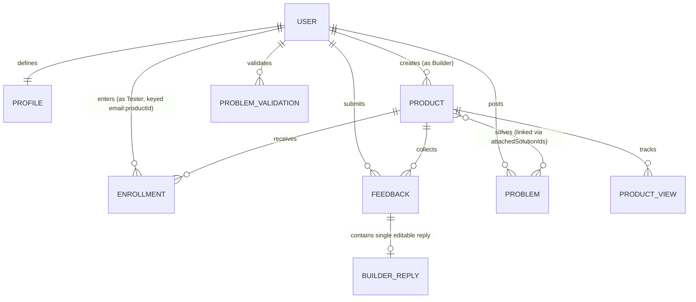

# BuildBoard — Full System Design Document (`system.md`)

This document provides the complete system architecture, domain modeling, component hierarchy, security threat model, and production migration blueprint for **BuildBoard**.

---

## Table of Contents
1. [Executive System Summary](#1-executive-system-summary)
2. [High-Level Architectural Architecture](#2-high-level-architectural-architecture)
3. [Domain Data Model & Schemas](#3-domain-data-model--schemas)
4. [Component Hierarchy & UI Topology](#4-component-hierarchy--ui-topology)
5. [Recommendation & Matching Algorithm Specification](#5-recommendation--matching-algorithm-specification)
6. [Security Architecture & Threat Model](#6-security-architecture--threat-model)
7. [Production Backend Migration Blueprint (MySQL + REST API)](#7-production-backend-migration-blueprint-mysql--rest-api)
8. [Performance & Scalability Characteristics](#8-performance--scalability-characteristics)

---

## 1. Executive System Summary

BuildBoard is a specialized peer-testing and product-critique network designed for indie hackers, early-stage founders, and technical beta testers. 

### Core System Philosophy
- **High-Signal Feedback over Upvotes**: The architecture rejects vanity counters and leaderboard algorithms in favor of a closed-loop testing protocol.
- **Explainable Matching**: Instead of non-deterministic AI agents, the platform employs deterministic tag and attribute vector matching with transparent scoring reasons.
- **Client-Side Prototype Isolation**: The current iteration functions as an autonomous, zero-dependency client application executing entirely inside the browser environment, persisting state to `Window.localStorage`.

---

## 2. High-Level Architectural Architecture

BuildBoard follows a **Modular Three-Tier Client Architecture**:

```
+---------------------------------------------------------------------------------------+
|                                    PRESENTATION LAYER                                 |
|                                                                                       |
|   React 19 (JSX)  •  React Router ^8.4.0  •  Tailwind CSS v4 Engine  •  Framer Motion |
|   - 15 Route Pages (/explore, /products/:id, /builder/dashboard, /problems, etc.)     |
|   - Per-page layout rendering (<Navbar /> and <Footer /> composed per page view)      |
|   - 12 Components in src/components/ (including standalone ProductCard,               |
|     ShowcaseCarousel, ThemeToggle)                                                    |
+---------------------------------------------------------------------------------------+
                                           │
                                           ▼
+---------------------------------------------------------------------------------------+
|                                  BUSINESS LOGIC LAYER                                 |
|                                                                                       |
|   Pure Utility Engines:                                                               |
|   - src/utils/recommendations.js (getRecommendedProducts: +1 unweighted per match)   |
|   - src/utils/feedbackReminder.js (getFeedbackReminderInfo: recent/early/followup)    |
|   - src/utils/indexedDB.js (IndexedDB binary blob storage for media uploads)          |
|                                                                                       |
|   Hierarchical Provider Context Tree (src/main.jsx):                                  |
|   <BrowserRouter>                                                                     |
|     └─► <ThemeProvider> (Dark/light mode root class & CSS variables)                  |
|           └─► <AuthProvider> (Firebase Auth session + Express API sync)               |
|                 └─► <DemoDataProvider> (Products, enrollments, feedback, problems)   |
|                       └─► <App />                                                     |
+---------------------------------------------------------------------------------------+
                                           │
                    ┌──────────────────────┴──────────────────────┐
                    ▼                                             ▼
+---------------------------------------+     +---------------------------------------+
|        CLIENT PERSISTENCE LAYER       |     |         BACKEND API & DATABASE        |
|                                       |     |                                       |
|   Browser Storage (Client Sandbox):   |     |   Node.js / Express 5 API (:3001):    |
|   - 8 LocalStorage Namespaces:        |     |   - Helmet security headers & CORS    |
|       1. buildboard_demo_custom_prods |     |   - Firebase Admin token verification |
|       2. buildboard_demo_enrollments  |     |   - POST /api/auth/me identity sync   |
|       3. buildboard_demo_feedback     |     |   - GET /api/health db ping           |
|       4. buildboard_demo_views        |     |                                       |
|       5. buildboard_demo_profiles     |     |   MySQL 8 Database (buildboard):      |
|       6. buildboard_demo_reminders    |     |   - users table (firebase_uid, email, |
|       7. buildboard_demo_problems     |     |     email_verified, created_at)       |
|       8. buildboard-theme             |     |   - Connection pooling via mysql2     |
|   - IndexedDB (buildboard_media_db)   |     +---------------------------------------+
|     for local screenshots & media     |
+---------------------------------------+
```

---

## 3. Domain Data Model & Schemas

### Entity Relationship Diagram (ERD)



---

### Detailed Entity Schemas

#### 1. User & Profile Entity (`UserProfile`)
Stored under localStorage key: `buildboard_demo_profiles` (keyed by `normalizedEmail`).
```typescript
interface UserProfile {
  email: string;                  // Primary key (normalized lowercase)
  name: string;                   // User display name
  role: 'builder' | 'tester' | 'both';
  bio?: string;
  experienceLevel?: 'Beginner' | 'Intermediate' | 'Advanced' | 'Expert';
  targetRoles: string[];          // e.g. ["Frontend Developer", "Product Manager"]
  targetIndustries: string[];     // e.g. ["Developer Tools", "Fintech", "AI/ML"]
  targetTechnologies: string[];   // e.g. ["React", "Python", "Tailwind", "Docker"]
  interests: string[];            // General category tags
  createdAt: string;              // ISO 8601 Timestamp
  updatedAt: string;
}
```

#### 2. Product Entity (`Product`)
Stored under localStorage key: `buildboard_demo_custom_products` and merged with `src/data/products.js`.
```typescript
interface Product {
  id: string;                     // Human-readable slug (e.g. "zenith-focus", with suffix on collision: "zenith-focus-4819")
  name: string;                   // Product name
  tagline: string;                // Short 1-sentence value proposition
  description: string;            // Extended markdown product description
  creatorEmail: string;           // Foreign key -> UserProfile.email
  creatorName?: string;           // Cached display name
  categories: string[];           // Primary categories (e.g. ["DevTools", "Productivity"])
  audience: string;               // Target user description text
  targetRoles: string[];          // Ideal tester roles
  targetIndustries: string[];     // Applicable industries
  targetTechnologies: string[];   // Required or used tech stacks
  targetExperience?: string;      // Optional experience requirement
  feedbackRequest: string;        // Explicit question the builder wants answered
  whatToTry: string[];            // Ordered steps/tasks for tester to execute
  productUrl: string;             // External prototype URL (GATED behind enrollment)
  githubUrl?: string;             // Optional source repository URL
  enrollmentPaused: boolean;      // Gate control (true = blocks new testers)
  createdAt: string;              // ISO 8601 Timestamp
  updatedAt: string;              // Note: Pausing must NOT alter updatedAt
  gallery?: string[];             // URLs / IndexedDB keys of product preview screenshots
}
```

#### 3. Enrollment Entity (`EnrollmentDictionary`)
Stored under localStorage key: `buildboard_demo_enrollments` as a key-value dictionary.
```typescript
// Key format: `${testerEmail.toLowerCase()}:${productId}`
// Value: ISO 8601 enrollment timestamp string
type EnrollmentDictionary = Record<string, string>;

// Example:
// {
//   "tester@buildboard.dev:zenith-focus": "2026-10-18T10:00:00.000Z"
// }
```

#### 4. Feedback Entity (`Feedback`)
Stored under localStorage key: `buildboard_demo_feedback`.
```typescript
interface Feedback {
  id: string;                     // e.g. "fb_1729123456789"
  productId: string;              // Foreign key -> Product.id
  userEmail: string;              // Foreign key -> UserProfile.email
  userName: string;               // Display name at time of submission
  category: 'What worked well' | 'Bug or issue' | 'Usability' | 'UI' | 'Feature idea' | 'Other';
  workflow: string;               // Context: "What were you trying to do?"
  outcome: string;                // Critique: "What happened vs expected?"
  experience?: string;            // Qualitative rating / overall experience
  likes?: number | string[];      // Helpful upvote count or voters
  isHelpful: boolean;             // Builder toggle (drives Recognition score)
  createdAt: string;              // ISO 8601 Timestamp
  reply?: BuilderReply;           // Single editable builder reply
}

interface BuilderReply {
  text: string;                   // Reply body text
  repliedBy: string;              // Builder email
  repliedAt: string;              // ISO 8601 creation timestamp
  updatedAt?: string;             // ISO 8601 edit timestamp
}
```

#### 5. Problem Validation Entity (`Problem`)
Stored under localStorage key: `buildboard_demo_problems` and merged with `src/data/problems.js`. Fully shipped with Reddit-style nested discussion comments.
```typescript
interface Problem {
  id: string;                     // e.g. "prob-1" or slug
  title: string;
  statement?: string;             // Core problem statement
  description: string;
  category: string;
  workarounds?: string;           // How users currently cope
  targetRoles: string[];
  targetIndustries: string[];
  authorEmail: string;
  authorName: string;
  validatedBy: string[];          // Array of voter emails who validated the problem
  testerSignups?: string[];       // Testers volunteering to test solutions
  attachedSolutionIds: string[];  // Array of Product.id solving this problem
  comments?: ProblemComment[];    // Nested comment hierarchy
  createdAt: string;
}

interface ProblemComment {
  id: string;
  authorName: string;
  authorEmail: string;
  text: string;
  createdAt: string;
  helpfulCount?: number;
  replies?: ProblemComment[];     // Nested replies with collapsible toggle
}
```

---

## 4. Component Hierarchy & UI Topology

BuildBoard renders `<Navbar />` and `<Footer />` inside each individual page component for modular styling and per-view control, rather than once globally in `App.jsx`.

```
<BrowserRouter>
 └─► <ThemeProvider>
       └─► <AuthProvider>
             └─► <DemoDataProvider>
                   └─► <App>
                        │
                        ├── <SkipToContent />             # Screen-reader skip navigation
                        ├── <OpeningIntro />              # 400ms entrance animation check
                        │
                        └── <Suspense fallback={<PageFallback />}>
                             └── <Routes>
                                  ├── <LandingPage>
                                  │    ├── <Navbar />
                                  │    ├── HeroSection & ProductSpotlight (inline spotlight)
                                  │    ├── <InteractiveBentoShowcase />
                                  │    ├── HowItWorksSection
                                  │    └── <Footer />
                                  │
                                  ├── <ExplorePage>
                                  │    ├── <Navbar />
                                  │    ├── SearchBar & CategoryFilters
                                  │    ├── RecommendationsRail
                                  │    ├── ProductGrid
                                  │    └── <Footer />
                                  │
                                  ├── <ProductDetailsPage>
                                  │    ├── <Navbar />
                                  │    ├── FeedbackReminderBanner (getFeedbackReminderInfo)
                                  │    ├── ProductHero, Gallery & Tagline
                                  │    ├── EnrollmentGate (Unlocks URL & Test Checklist)
                                  │    ├── WhatToTryList
                                  │    ├── FeedbackSubmissionForm (6 categories + experience)
                                  │    ├── FeedbackThreadFeed (Single editable reply per note)
                                  │    └── <Footer />
                                  │
                                  ├── <SubmitProductPage> (Multi-step listing builder with IndexedDB media)
                                  ├── <BuilderDashboardPage> (Metrics: Views, Enrolled, Feedback)
                                  ├── <TesterActivityPage> (Active enrollments, Recognition)
                                  ├── <ProfileSetupPage> (Role, Industry, Tech tag selectors)
                                  ├── <ProblemsPage> / <SubmitProblemPage> / <ProblemDetailsPage>
                                  ├── <VerifyEmailPage> (Simulated email verification)
                                  ├── <SignInPage> / <SignUpPage> / <NotFoundPage>
                                  └── <AboutPage>
```

> [!NOTE]
> **Component Library Status**: There are 12 component files in `src/components/`. `ProductCard.jsx`, `ShowcaseCarousel.jsx`, and `ThemeToggle.jsx` are standalone modular building blocks in `src/components/` that are currently unimported in the active routes (the landing page uses an inline `ProductSpotlight` rather than `ShowcaseCarousel`, and individual pages manage themes and cards directly).

---

## 5. Recommendation & Matching Algorithm Specification

Implemented in `src/utils/recommendations.js` via `getRecommendedProducts(products, profile, limit = 4)`.

### Mathematical Scoring Function
Every matching criterion adds exactly **+1 point** to the total match score. The total score is equal to the total count of matched reasons:

$$\text{Score}(P, U) = |P_{\text{categories}} \cap U_{\text{interests}}| + |P_{\text{roles}} \cap U_{\text{roles}}| + |P_{\text{tech}} \cap U_{\text{tech}}| + |P_{\text{industries}} \cap U_{\text{industries}}| + E(P, U)$$

Where experience match $E(P, U)$:
$$E(P, U) = \begin{cases} 
1 & \text{if } P_{\text{targetExperience}} \neq \text{null and } P_{\text{targetExperience}} = U_{\text{experienceLevel}} \\
0 & \text{otherwise}
\end{cases}$$

### Match Reasons & Ranking
- **Score Calculation**: $\text{Score} = \text{reasons.length}$.
- **Transparent Explanations**: Each matching attribute generates a human-readable explanation string (e.g. `"Matches your role: Frontend Developer"`, `"Uses React"`, `"Matches your interest in DevTools"`).
- **Ranking**: Products are sorted in descending order of `matchScore`. Only products with $\text{Score} > 0$ are included in recommendations.
- **No Category Labels**: Unlike earlier draft proposals, the code does not classify products into "High / Moderate / Low" match badges. Products display the exact match count and reason bullet list directly.

---

## 6. Security Architecture & Threat Model

### Current Hybrid Prototype Security Posture
1. **Production Authentication Implemented**: Authentication is handled by Firebase Authentication. User credentials, salted password hashes, and email verification tokens never hit our application server. The frontend client exchanges Firebase ID tokens with the Express API over `Authorization: Bearer <token>`.
2. **Server-Side Token Verification (`requireAuth.js`)**: The backend utilizes `firebase-admin/auth` with `verifyIdToken(token, true)` to verify cryptographic signature, expiration, and revocation status. Accounts with unverified emails (`email_verified = false`) are rejected with `403 Forbidden`.
3. **HTTP Hardening**: The Express server implements `helmet()` for secure HTTP headers, strict origin-filtered `cors()`, and payload size limits (`32kb`).
4. **Client-Side Domain Storage (Temporary)**: In the current milestone, product listings, checklists, and reviews remain in browser `localStorage`/`IndexedDB` demo data. Server-enforced URL masking will occur during the upcoming domain data migration.

### Production Security Model (Target Architecture)
```
                                CLIENT UNTRUSTED BOUNDARY
─────────────────────────────────────────────────────────────────────────────────────────
                                SERVER TRUSTED BOUNDARY

[Client Browser] 
       │
       ├─► 1. Firebase Authentication (Client SDK: Email/Password, Email Verification)
       │     └─► Obtains cryptographically signed Firebase ID token (JWT)
       │
       ├─► 2. Express 5 API Server (:3001)
       │     ├─► Helmet HTTP protection & CORS origin whitelist
       │     ├─► requireAuth middleware: firebaseAuth.verifyIdToken(token, checkRevoked)
       │     ├─► Extracts verified claims: uid, email, email_verified
       │     └─► Server-Enforced Enrollment Gate (Upcoming):
       │           'productUrl' is ONLY included in JSON payload if:
       │           EXISTS(SELECT 1 FROM enrollments WHERE user_id = req.user.id)
       │
       └─► 3. MySQL 8 Database (buildboard)
             ├─► users table: keyed by stable firebase_uid
             └─► Foreign key relations (products, feedback, enrollments) with ON DELETE CASCADE
```

---

## 7. Production Backend Migration Blueprint (MySQL + REST API)

> **Implementation Status**: Step 1 (Users Table & Token Authentication) is **Shipped** in `backend/schema.sql` and `backend/src/routes/auth.js`. Steps 2–9 below represent the migration target for domain models.

### MySQL Relational Database Schema DDL

```sql
-- 1. Users Table
CREATE TABLE users (
    id VARCHAR(36) PRIMARY KEY,
    email VARCHAR(255) NOT NULL UNIQUE,
    password_hash VARCHAR(255) NULL,
    name VARCHAR(100) NOT NULL,
    role ENUM('builder', 'tester', 'both') DEFAULT 'both',
    bio TEXT,
    experience_level ENUM('Beginner', 'Intermediate', 'Advanced', 'Expert'),
    created_at TIMESTAMP DEFAULT CURRENT_TIMESTAMP,
    updated_at TIMESTAMP DEFAULT CURRENT_TIMESTAMP ON UPDATE CURRENT_TIMESTAMP
);

-- 2. User Profiles Targeting Tags
CREATE TABLE user_target_tags (
    id BIGINT AUTO_INCREMENT PRIMARY KEY,
    user_id VARCHAR(36) NOT NULL,
    tag_type ENUM('role', 'industry', 'technology', 'interest') NOT NULL,
    tag_value VARCHAR(100) NOT NULL,
    FOREIGN KEY (user_id) REFERENCES users(id) ON DELETE CASCADE,
    UNIQUE KEY uq_user_tag (user_id, tag_type, tag_value)
);

-- 3. Products Table
CREATE TABLE products (
    id VARCHAR(36) PRIMARY KEY,
    creator_id VARCHAR(36) NOT NULL,
    name VARCHAR(150) NOT NULL,
    tagline VARCHAR(255) NOT NULL,
    description TEXT NOT NULL,
    audience TEXT,
    target_experience VARCHAR(50),
    feedback_request TEXT NOT NULL,
    product_url VARCHAR(500) NOT NULL,
    github_url VARCHAR(500),
    enrollment_paused BOOLEAN DEFAULT FALSE,
    created_at TIMESTAMP DEFAULT CURRENT_TIMESTAMP,
    updated_at TIMESTAMP DEFAULT CURRENT_TIMESTAMP,
    FOREIGN KEY (creator_id) REFERENCES users(id) ON DELETE RESTRICT
);

-- 4. Product Target Criteria
CREATE TABLE product_target_criteria (
    id BIGINT AUTO_INCREMENT PRIMARY KEY,
    product_id VARCHAR(36) NOT NULL,
    criteria_type ENUM('category', 'role', 'industry', 'technology') NOT NULL,
    criteria_value VARCHAR(100) NOT NULL,
    FOREIGN KEY (product_id) REFERENCES products(id) ON DELETE CASCADE,
    INDEX idx_product_criteria (criteria_type, criteria_value)
);

-- 5. Product Test Steps ("What to Try")
CREATE TABLE product_test_steps (
    id BIGINT AUTO_INCREMENT PRIMARY KEY,
    product_id VARCHAR(36) NOT NULL,
    step_order INT NOT NULL,
    instruction TEXT NOT NULL,
    FOREIGN KEY (product_id) REFERENCES products(id) ON DELETE CASCADE
);

-- 6. Enrollments Table (Unique constraint prevents double enrollments)
CREATE TABLE enrollments (
    id VARCHAR(36) PRIMARY KEY,
    product_id VARCHAR(36) NOT NULL,
    tester_id VARCHAR(36) NOT NULL,
    enrolled_at TIMESTAMP DEFAULT CURRENT_TIMESTAMP,
    FOREIGN KEY (product_id) REFERENCES products(id) ON DELETE CASCADE,
    FOREIGN KEY (tester_id) REFERENCES users(id) ON DELETE CASCADE,
    UNIQUE KEY uq_tester_product (tester_id, product_id)
);

-- 7. Feedback Submissions
CREATE TABLE feedback (
    id VARCHAR(36) PRIMARY KEY,
    product_id VARCHAR(36) NOT NULL,
    tester_id VARCHAR(36) NOT NULL,
    category ENUM('Bug', 'UX / Usability', 'Feature Request', 'Performance', 'General') NOT NULL,
    workflow TEXT NOT NULL,
    outcome TEXT NOT NULL,
    is_helpful BOOLEAN DEFAULT FALSE,
    created_at TIMESTAMP DEFAULT CURRENT_TIMESTAMP,
    FOREIGN KEY (product_id) REFERENCES products(id) ON DELETE CASCADE,
    FOREIGN KEY (tester_id) REFERENCES users(id) ON DELETE CASCADE
);

-- 8. Builder Feedback Replies
CREATE TABLE feedback_replies (
    id VARCHAR(36) PRIMARY KEY,
    feedback_id VARCHAR(36) NOT NULL,
    author_id VARCHAR(36) NOT NULL,
    reply_text TEXT NOT NULL,
    created_at TIMESTAMP DEFAULT CURRENT_TIMESTAMP,
    FOREIGN KEY (feedback_id) REFERENCES feedback(id) ON DELETE CASCADE,
    FOREIGN KEY (author_id) REFERENCES users(id) ON DELETE CASCADE
);

-- 9. Product Views Counter
CREATE TABLE product_views (
    product_id VARCHAR(36) PRIMARY KEY,
    view_count BIGINT DEFAULT 0,
    last_viewed_at TIMESTAMP DEFAULT CURRENT_TIMESTAMP ON UPDATE CURRENT_TIMESTAMP,
    FOREIGN KEY (product_id) REFERENCES products(id) ON DELETE CASCADE
);
```

---

### REST API Endpoint Specification

| Method | Endpoint | Access | Description |
| :--- | :--- | :--- | :--- |
| `POST` | `/api/v1/auth/sign-in` | Public | Authenticates credentials, returns secure cookie |
| `POST` | `/api/v1/auth/sign-up` | Public | Registers user profile |
| `GET` | `/api/v1/products` | Public | Returns product catalog (without `product_url`) |
| `GET` | `/api/v1/products/:id` | Public | Returns product details (masks `product_url` if not enrolled) |
| `POST` | `/api/v1/products` | Builder | Creates new product listing |
| `PATCH` | `/api/v1/products/:id/pause` | Owner | Toggles enrollment pause state |
| `POST` | `/api/v1/products/:id/enroll` | Tester | Enrolls tester and reveals `product_url` |
| `POST` | `/api/v1/products/:id/feedback`| Enrolled | Submits structured feedback |
| `POST` | `/api/v1/feedback/:id/reply` | Owner | Adds builder response to feedback |
| `PATCH` | `/api/v1/feedback/:id/helpful`| Owner | Toggles helpful mark (updates recognition) |
| `GET` | `/api/v1/tester/activity` | Tester | Retrieves enrollments, reminders, and feedback history |
| `GET` | `/api/v1/builder/dashboard` | Builder | Returns aggregate metrics (views, conversion rate) |

---

## 8. Performance & Scalability Characteristics

1. **Client Bundle Optimization**:
   - Dynamic route splitting (`React.lazy`) divides the application into lightweight page chunks loaded on-demand.
   - Initial load payload is restricted to core layout components (`Navbar`, `Footer`, `AuthContext`), maintaining fast Largest Contentful Paint (LCP) times.
2. **Deterministic Recommendation Speed**:
   - `computeProductMatch` operates in $O(N \cdot M)$ time where $N$ is product count and $M$ is tag count ($<15$ tags).
   - Entire catalog recommendation sorting runs in $< 2\text{ms}$ on standard hardware.
3. **Database Performance Target (Post-Migration)**:
   - Composite index on `(criteria_type, criteria_value)` allows fast tag-intersection queries using relational `JOIN` operations.
   - Product view tracking can be buffered in a Redis counter (`INCR product:views:<id>`) and flushed to MySQL periodically via background job to avoid database write contention.
